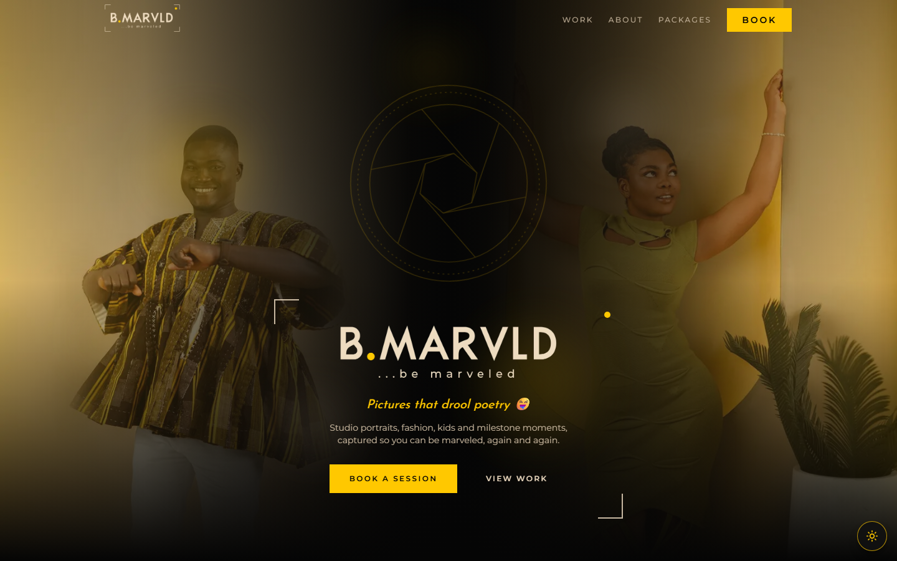

# B.Marvld Photography

The website and booking system for B.Marvld, a photography studio in Accra: portfolio, packages, booking with a Paystack deposit, and a private gallery for every client.

**Live:** [bmarvld.com](https://bmarvld.com)



## What it does

**For clients**
- Browse the portfolio and packages, pick a date and pay a deposit with mobile money or card (Paystack)
- After the shoot, open a private link to see watermarked proofs and pick favourites
- Receive the edited photos through a second link, clean and full size, and star the ones they'd like featured on the site
- Get booking confirmations by email and SMS

**For the photographer** (`/admin`)
- Sign in with a one-time code sent by email; there's no password to leak
- See bookings, record manual ones, and block days off
- Manage packages and their order on the site
- Upload photos from a computer, or paste a Google Drive link and import a whole shoot
- Create a gallery per client, share proof and delivery links, and download the client's picks as a zip

## How the booking can't be double-booked

Two clients can reach checkout for the same date at the same moment. Instead of checking availability in code (which can lose that race), each calendar date is a single MongoDB document whose `_id` is the date itself, so the database refuses a second one.

| State | Meaning |
| --- | --- |
| `hold` | Someone is at Paystack checkout for this date; expires after 30 minutes |
| `booked` | The deposit was paid |
| `blocked` | The photographer closed the date |

Payments are confirmed by both the redirect back to the site and Paystack's signed webhook; both run the same idempotent step. If a payment ever arrives for a date someone else now holds, the booking is marked `needs_refund` rather than double-booked.

## How photos move

```
Computer upload ─► signed upload straight to Cloudinary ─┐
                                                          ├─► site records it, checks it's in this gallery's folder
Drive link ─► Drive API lists the photos ─► Cloudinary fetches each one from Drive ─┘
```

Photos never pass through this server, so large shoots import quickly even from a phone. Proofs are only ever served watermarked.

## Stack

Next.js 16 (App Router) · Hono (one API on a catch-all route) · MongoDB · Zod · Paystack · Cloudinary · Google Drive API · Nodemailer · mNotify SMS · Vercel

## Run it locally

```bash
npm install
# create .env.local with the variables below
npm run seed:demo   # optional demo packages, bookings and galleries
npm run dev
```

| Variable | What it's for |
| --- | --- |
| `MONGODB_URI`, `MONGODB_DB` | Database |
| `APP_URL` | Public base URL |
| `ADMIN_EMAILS`, `ADMIN_PHONES`, `ADMIN_SESSION_SECRET` | Who can sign in to `/admin`, and session signing |
| `PAYSTACK_SECRET_KEY` | Deposits and webhook verification |
| `CLOUDINARY_CLOUD_NAME`, `CLOUDINARY_API_KEY`, `CLOUDINARY_API_SECRET`, `CLOUDINARY_UPLOAD_FOLDER` | Photo storage |
| `GOOGLE_API_KEY` | Listing shared Drive folders ([setup](docs/google-drive-setup.md)) |
| `SMTP_USER`, `SMTP_PASS` | Email |
| `MNOTIFY_KEY`, `MNOTIFY_SENDER_ID` | SMS |

---

Built by [Collins Marfo](https://github.com/kwabena-marfo).
